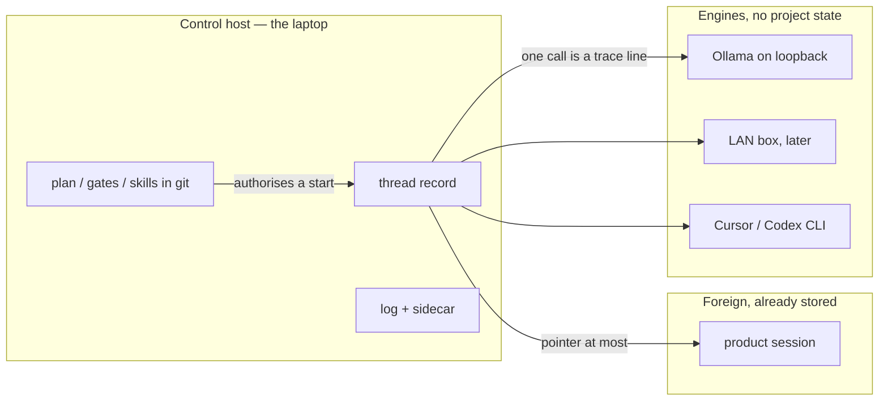

# Projet Complexe 2026 Revival (v6)

## ASC, Projet Complexe, and Projet Complexe ASC — runs, sessions, plans, and where the bytes live

**Date:** 2026-11-11  
**Status:** architecture note / design instrument (not a spec, not an implementation plan, not an approval to build)  
**Keeps:** Revival v2 (three-project cut, killswitch, genericity); v3 (extract-once, lexical-first retrieval); v4 (hooks around LLM calls, tools as entry points, DSL vs MCP); v5 (Meadows / Lefèvre / Monnin as tests, triage before packing, Tiiny as a Technology, Claims committed by a human). The v5 glossary and literature table stay in [v5](<Projet Complexe 2026 Revival (v5) - ASC, Projet Complexe and Projet Complexe ASC.md>). This note amends them where the November survey disagrees, and does not reprint them.  
**Adds:** a placement of every byte that an “agent running” might be — thread, session, model server, plan, gate, need, skill, trace — with what was **observed** in code and on this host, what earlier reviews **propose**, what products document as **external**, and what stays **open**.

This note exists because a same-day pass over the mother, the home ASC instance, this tree, and the earlier review shelves produced four short draft specs and seven idea notes. Those files are the right size for a contract. They are the wrong size for the reasoning that chose them. v5 already knew the mission and the harness. It did not yet say which file is the run, which store is forbidden to copy, which verb is actually missing, or which of its own sentences the later reviews reversed.

> ASC is authoritative about execution. Projet Complexe is authoritative about interpretation. The coupling between them is the product — not the model.

The November survey adds a second sentence, same rank:

> ASC records the process it started. The product records the conversation. The model server records neither. A central store that merges the three is the abstraction this pass is here to refuse.

Labels used below:

| Label | Means |
|---|---|
| **Observed** | Read in the mother tree, or counted on this host, on 2026-11-11. |
| **Proposed** | Written in a plan, an idea, or a review sketch. Not implemented. Not approved. |
| **External** | A product’s files or documentation. Products change these without notice. Headless commands were read, not exercised, except one throwaway systemd user unit. |
| **Open** | Still a choice. A “lean” in this note is a recommendation, not a decision. |

Short contracts, if they are adopted, live in the mother as drafts: `docs/specs/asc/agent-threads.md`, `agent-chats.md`, `agent-plans.md`, `agent-skills.md`, each with `status: draft`. The reasoning sits beside them in `docs/ideas/2026/11/11-agent-*.md` and `11-record-conventions.md`. This note is the revival-series form of that reasoning, written so a later stage can implement without mining the shelves again.

---

# 0. Verdict

## 0.1 What changed since v5

v5 answered what the glue is for: a living map, a Flow band, a stack you can turn off. It left the bytes of a run unspecified, and in a few places it left them contradictory (Postgres job rows in one paragraph, files for episodic traces in another, `stop-agent` as a name with no verb behind it).

The survey’s structural result is small:

1. **Three different things are called “an agent running.”** A thread, a session, and a model server. Only the thread gets an ASC record.
2. **The LAN box is a provider.** A laptop thread that calls a large model on the LAN still runs on the laptop. Cross-host tracking begins only when a second machine starts ASC entry points itself.
3. **The record that exists cannot tell two runs apart.** `data/threads/$entry.yml` is overwritten. It has no run id, no host, and no timezone offset. The host index repeats that latest-only shape and is healed by a sweep the default configuration does not run.
4. **The verb that is actually missing is stop.** List, status, batch, sequence, and pipe exist. Killing the recorded pid leaves the harness’s children. A cgroup is the reliable stop. `systemd-run --user` already supplies the cgroup, the journal, and an invocation id.
5. **“Queue” is two levels.** The work-item backlog (gates, next-steps, plans) is unsettled and already has files. The process queue has no demonstrated waiting list. “Do not starve the editor” is a scheduler weight, not a queue.
6. **A transcript is a foreign artefact.** Cursor, Codex, and Claude Code already store it. ASC keeps a pointer and a turn result. It does not keep a copy.
7. **Readiness is not authorisation.** `plan-is 'ready'` can say the evidence matches. A human, or a gates file that nothing currently reads, says the step may start.
8. **A skill is a hand-written brief.** The stage-1 source is `.agents/skills/$id/SKILL.md`. Rendering `SKILL.md` from a YAML entity is an older path that still exists only on the home instance. v5’s “optionally emit SKILL.md from YAML” is amended in §16.

Nothing in that list is a new product. It is a placement.

## 0.2 What this note recommends, still unapproved

In the order the survey argued, cheapest first:

1. Add `run_id`, `host`, and a UTC offset to the thread record and the host index. Every richer option needs them. History can wait.
2. Try one long entry under `systemd-run --user` before writing a JSONL run ledger. If the journal is enough history on systemd hosts, the ledger is a second copy.
3. Add `thread-stop` only once the supervisor can signal a process group or a unit. Until then a stop action is a pid kill with orphans.
4. Leave the process queue alone. Keep `flock`. If a real waiting list appears, try `pueue` before any ASC queue code. Settle gates versus next-steps before calling either “the backlog.”
5. Keep chat turns as one JSON object on stdout, one hook implementation per product and role, no adapter layer, no transcript database.
6. Move model-server pivots from `agent-*` to `llm-*`, so `agent-stop` stops meaning “unload a model.”
7. Keep skills hand-written. An install action, if it is ever built, copies a known directory into an empty destination and records ownership. It does not become a package manager.
8. Refuse a listener, a broker, a LAN-wide run database, a memory MCP, and any design in which the model writes the record.

## 0.3 What v5 must not lose while this is absorbed

The groundwork tests still judge every row above. A run id is a small information-flow fix (Meadows, around the stock of records). A queue daemon or a collector is a new attachment (Monnin) at the paradigm layer, spent to solve a waiting list that does not exist. Autonomy remains the coupling with a world that remembers and refuses (Lefèvre): the filesystem, the lock, the journal, the human. The model is one interlocutor among others. Indexes remain the intelligence on this laptop. fr / en / pt remain Requirements. HITL remains the commit of a Claim.

---

# 1. Terms this update adds or revises

v5’s jargon table still defines Claim, KnowledgeGap, CLR, packing, triage, Technology, hook, pivot, DSL, MCP, and the rest. The rows below are the ones v5 left soft, or that the survey had to split before any file layout could be true.

| Term | What it is here | What it must not be confused with |
|---|---|---|
| Thread | The process tree of one make entry point, on the host that started it. The code records it in `data/threads/$entry.yml`. | A chat session. A POSIX thread as a programming object. v3’s phrase “an execution pivot, not necessarily a POSIX thread” still names the *pivot* (`thread-*`). The record, observed, is an OS tree. |
| Run | One start-to-exit of a thread. The unit the survey wants. The code still keys by entry, so two runs of `extract` share one file. | A cron `run_id`. The crontab extension already uses that word for *which cron job* (`ASC_CRON_RUN`, for example `thread-monitor`). A thread run id is a different field. |
| Session / chat | A conversation owned by Cursor, Codex, or Claude Code. It outlives processes and may have none. | A thread. A Projet Complexe coordinate. A Claim. |
| Model server | A long-lived process that answers inference requests: Ollama today; Ollaya if it is installed; a LAN endpoint later. | A run. A decision-model *call* is a line in the caller’s trace, milliseconds long. |
| Provider / Technology | The swappable engine named in configuration (`ollama`, `lan-box`, a CLI harness). v5’s word stands. | A host. The brand of a box. An address. |
| Host | The machine that started the entry point. The laptop is the control host in every review. | The LAN box. The machine that merely serves tokens. |
| Place | `laptop`, `lan`, or `dedi`, as the devops reviews name Environments. Lower case. | A hostname. A brand. |
| Backlog | Work a human has accepted as worth doing, ordered by a human, living for days. Candidate homes: gates rows, a next-steps file, checkboxes in a plan. | A process queue. |
| Queue | Commands waiting for a slot, living for seconds to hours. | The backlog. Codex’s own per-thread turn queue, which already exists inside Codex and was empty on the day of the survey. |
| Priority (order) | Which backlog item goes first. Today: `order:` in a gates file nobody reads. | Priority (weight). |
| Priority (weight) | Which running process gets the CPU and the disk: `nice`, `ionice`, a systemd slice. This is the need behind “the agent should not starve the editor.” | A queue number. |
| Readiness | Whether the evidence for a named plan step is present and consistent. Proposed predicate: `plan-is 'ready'`. | Authorisation. |
| Authorisation | Whether a human has allowed the step to start. | A model verdict. A green readiness answer. |
| Turn result | One JSON object on stdout from `chat-new` or `chat-reply`: ok, ids, prompt, reply text, status, error. Proposed. | A transcript. |
| Pointer | Provider plus `provider_session_id`, small enough to live on a thread or in a later chat file. | A copy of the product’s JSONL. |
| Skill | A directory whose `SKILL.md` tells an agent when and how to follow a procedure. The procedure’s executable, if any, is a make entry point. | A tool. A Claim. A rendered projection. An extension being enabled. |
| Need | One dated Markdown file for something unmet. Proposed inbox under `$HOME/.local/state/asc/needs/`. The plan that proposes it says it is not a queue. | A gates row. A dispatch ticket. |
| Trace | A proposed append-only line about what a call did: pivot, Technology, Task, tokens, outcome. | The thread record (that a process ran). The journal (that a unit started and exited). A Claim. |
| Hold file | A proposed file the wrapper refuses to start under. Survives reboot. No daemon. | v5’s orientation killswitch (a research catalog with no `bash`; a Task that writes a KnowledgeGap). Both are stops. They stop different things. |
| SoR / SoT | Unchanged from v5. Files for bytes; Postgres, when it exists, for Claims and jobs. YAML `able` is SoT for tool schemas. | A transcript store. A run ledger. Those are derived or foreign. |

If a vendor word is still missing from v5’s table and from this one, treat that as a hint: it probably should not become identity.

---

# 2. Where each object lives

Same three projects as v2 and as `app/README.md`. The survey’s job was to stop them sharing a database.

```text
Projet Complexe       meaning: Task, Claim, Link, KnowledgeGap, coordinate, mode
        ↓
Projet Complexe ASC   which pivots, which pack, which Technology, which allowlist
        ↓
ASC                   names, hooks, thread records, logs, the make entry that actually ran
```

| Object | Owner | Store, observed or proposed | What the others may keep |
|---|---|---|---|
| Thread record | ASC | Observed: `data/threads/$entry.yml`, git-ignored, one file per entry per project, overwritten | PCA may read status. PC may show “this Task’s last run.” Neither copies the YAML into the graph. |
| Host index | ASC, on the host | Observed: `$HOME/.local/share/asc/threads/$hash.yml`, latest only | A reader on the laptop. No sync. No git. |
| Logs | ASC | Observed: `data/logs/$entry.txt` truncated each run; `.sidecar.txt` appended, launch line only | Tail or `journalctl`. No new “read log” pivot. |
| Session bytes | The product | External: under the user’s home, per product, §8 | ASC: a pointer. PC: a Note, only if a human promotes a summary. |
| Turn result | The caller | Proposed: JSON on stdout; optional `result:$path` mirror | A thread field, once a thread drives a chat. A chat file only when a second run must resume by name. |
| Model server | The service manager | Observed for Ollama: a system unit on loopback. Proposed for a LAN box: a status probe | A `technology` field on the trace of the caller. |
| Plan | The human who edits `docs/plans/` | Observed path convention in the mother. Content shape is proposed | PC’s Task may *refer* to a plan. The plan file is not a Claim. |
| Review result | The reviewer role | Proposed JSON, bound to the plan’s sha256 | Not a Claim. `unknown` stays unknown. |
| Gates / next-steps | Unsettled | Observed files in the mother; nothing in the runtime reads the gates file | Not the knowledge graph. Not the process queue. |
| Need | Unsettled; proposed as host state | `$HOME/.local/state/asc/needs/…` | May later justify a skill edit or a plan. It does not dispatch. |
| Skill | The human author | Observed: `.agents/skills/$id/SKILL.md` in git | Products discover it. Discovery is not compliance. |
| Tool schema | ASC YAML `able`, when a real contract exists | SoT for JSON Schema / MCP / TypeBox projections | A skill may *name* an entry point. It does not redefine the schema. |
| Claim, Link, Gap | Projet Complexe | v5: Postgres when it earns its keep; files until then | Agents propose. Humans accept. A trace is evidence for a proposal, not the proposal. |
| Trace line | Proposed; owner would be the wrapper, never the model | Reviews disagree: Postgres row vs `traces/YYYY/MM/DD.$host.jsonl`. §12 | Rebuildable. Not synced as a live database. Not the conceptual graph. |

Rule of thumb, unchanged, now with a storage corollary: Projet Complexe should use ASC without becoming ASC-specific; PCA should use ASC specifically without becoming a second ASC; neither should become the product’s session store.

Lefèvre’s correction still holds: the agent is the coupling, not the weights. The survey names the world that coupling actually touches on this host: a YAML file, a lock, a product JSONL the agent does not own, a human, and a model server that forgets the Task the moment the HTTP call ends.



---

# 3. Groundwork, applied to these bytes

v5 §2 stays in force. This is the same three tests, pointed at tracking.

## 3.1 Meadows

| Spend | On this material | v1? |
|---|---|---|
| Parameters (12) | temperature, `num_ctx`, chunk size | Still no. |
| Buffers (11) | a bigger transcript archive, a LAN database of runs | No. The products already buffer the chats. |
| Stocks and flows (10) | one record per run that can be merged; extract-once unchanged | Yes: `run_id` and offset are this layer. They are small because the stock is already the wrong shape. |
| Delays (9) | nightly distillation of Claims; a sweep that heals stale pids | The sweep already exists and does not run. Fix the caller before inventing a new delay. |
| Balancing loops (8) | `thread-stop`, hold file, `plan-is` returning `unknown` | Yes, once stop has a cgroup. |
| Information flows (6) | triage before packing; a host list that is actually readable | The index is written and has no reader. A reader is this layer. A dashboard is not. |
| Rules (5) | allowlists, `lan-only`, “the model never writes a record,” readiness ≠ authorisation | Yes. |
| Goals (3) | track work so it can be stopped and resumed; do not “build a control plane” | Yes. |
| Paradigm (2) | collaborator, closable engines, files as SoR | A collector would be a paradigm change. Refuse it here, not after it exists. |

## 3.2 Lefèvre

A thread that cannot be stopped, a session the product will resume after the process is dead, and a model server that does not know the Task: those are three different resolutions.

| World’s answer | Mode, in Lefèvre’s words | In this design |
|---|---|---|
| The tool ran and returned JSON | karma — means suffice | Allowlisted entry point, deterministic `plan-is` |
| A human accepts a Claim or a gates row | drama — authority decides | HITL. A reviewer model is not the authority |
| The pid was reused, the box slept, the journal rotated | fortune — chance, then a new present | `stale`, `unknown`, a dangling pointer. Record them. Do not coerce them to success |

The institution (`meneur`) is still PCA’s allowlist plus ASC’s hooks plus the human. It is not a second narrator, and it is not `systemd` itself. systemd is a means in the world: it kills a cgroup. It does not decide that the Task is done.

## 3.3 Monnin

Every new supervisor is an attachment. Name the closure before adding it.

| Candidate | Attachment | How it is turned off |
|---|---|---|
| Fields on the existing YAML | Almost none | Stop writing them |
| systemd user units | Lingering, journal caps, a second code path for hosts without systemd | `systemctl --user stop`; the wrapper path remains for non-systemd |
| A queue daemon (`pueue`) | A Rust service on every host, a second supervisor beside systemd | Uninstall. Do not add it until a waiting list exists |
| A JSONL ledger | Another tree to explain, back up, and not sync | Delete the files; the journal or the sidecar remains |
| A LAN collector | A machine that must be up for the laptop to know itself | This is the zombie. The reviews refuse it |
| The LAN inference box | Power, a vendor engine, LAN trust, a proxy token | `how_to_turn_off` is mandatory in the router policy or the Technology is inadmissible (review decision). Stage 1 still runs when the box is unplugged |

v5’s Illich test is unchanged: if Ollama is stopped, `extract` still runs. If the box is away, the laptop path still runs. If Cursor is closed, the thread record still says what ASC started.

---

# 4. What the code and this host actually do

Method. Mother code under `asc/thread/`, `asc/log/`, `asc/extensions/agent/`, `asc/extensions/crontab/`, and `asc/core/upgrade.sh` was read on 2026-11-11. The home directory, which is itself an ASC instance, was compared with `diff -rq` on the relevant trees. Product stores were listed for shape and counts; their message text was not copied into any note. One throwaway `systemd-run --user` unit was started and exited on its own, to see journal fields. Listing and stopping a live unit were refused by the review gate of that session and were not retried. Queue tools were not installed. Headless agent CLIs were not executed. The mother was not pulled: its work tree was already dirty.

## 4.1 The thread record (observed)

`f_thread_yml_write` in `asc/thread/thread.inc.sh` writes `data/threads/$entry.yml`. The key is the make entry point name. A second run of the same entry replaces the file.

Keys written: `entry`, `owner`, `uid`, `euid`, `run_as`, `sudoing`, `script`, `args`, `pid`, `ppid`, `started_ms`, `status`, `exit_code`, `ended_ms`, `output`, `attempt`, `max_attempts`, `lock_mode`, `trigger`, `needs_interactive`, and, when the tree was captured, `tree` as `pid:comm` lines.

`started_ms` is `date +%Y-%m-%dT%H:%M:%S.%3N`. Local time. No offset. Two machines cannot be ordered from these strings.

`status` is `running`, `exited`, or `stale`. `stale` means the record says `running` and `kill -0 $pid` fails. A recycled pid therefore still looks alive. The tree list is a snapshot at start, not a membership that stop could trust.

The recorded pid is the supervisor’s `$BASHPID`, set inside `f_thread_supervised_run`. The log-wrapped path backgrounds that function. The plain path runs it in a subshell with `trap '' HUP`, stdout and stderr appended to `nohup.out`. There is no process group of its own. Children that a harness later re-parents are outside the snapshot.

Lock: `data/threads/$entry.lock`, `flock` on fd 9. `ASC_THREAD_LOCK_MODE` defaults to `skip`. `wait` blocks. Waiters are live processes; reboot drops them; order among waiters is not guaranteed.

A second start that finds the entry already running prints a skip line and **exits 0**, and the lock-busy path inside the supervisor returns without overwriting the running YAML. Callers that treat exit 0 as “I started it” are wrong. That is observed behaviour, and it is one reason a run id has to exist before any queue is discussed: the current success code does not mean a new run.

Retries: `ASC_WRAP_RETRY_MAX` defaults to 0, delay `10s`. Exit 0, 130, and 143 are not retried. Exits 75, 126, and 130 set `needs_interactive`. Nothing notifies a human; the flag sits in the YAML.

Stdin of a wrapped command is `/dev/null`. `ASC_WRAP_NONINTERACTIVE=1` and `GIT_TERMINAL_PROMPT=0` are exported. Scripts marked `@requires interactive` are refused. `@requires sudoing` without root is refused.

Actions that exist: `thread-wrap`, `log-wrap`, `thread-list`, `thread-status`, `thread-batch` (`workers:N`), `thread-sequence`, `thread-pipe`, `log-rotate`, and the logged aliases `lt`, `lb`, `ls`, `lp`. `logged-chain` (`lc`) wraps `asc/instance/chain.sh`, not the thread action. `logged-loop` (`ll`) calls `asc/loop/loop.wrap.sh`. **`asc/loop/` does not exist.**

`thread-status` exits 0 when running, 2 when not, 1 when there is no record. `thread-list` reads the project directory only.

Actions that do not exist: stop, stop-all, queue, prioritise, a time limit, a host-wide list, a cross-host list.

## 4.2 The host index (observed)

On each write, `f_thread_host_publish` also writes `$HOME/.local/share/asc/threads/$slug.yml` unless `ASC_MONITORING` or `ASC_HOST_THREAD_MONITOR` is off. `$slug` is the first 16 hex characters of `sha256sum` over the string `docroot::entry` **plus a newline** (`printf '%s\n'`). A reimplementation that hashes the string without the newline will not find the files.

Index keys: `docroot`, `entry`, `pid`, `status`, `owner`, `mtime`, `trigger`. No run id, no host, no exit code. Latest only, same as the project file.

The heal path is the `thread` `monitor` hook. Its only caller in the mother is the crontab extension, and that extension is in `.asc_extensions_ignore` by default. With defaults, the index is written and never corrected.

On this host, on the survey day: five index files, last written between 21 and 27 September, three `exited`, one `stale`, one still saying `running`. The home crontab still contains a `thread-monitor` line inside an old marked block, invoking `make cron-run`, and `cron-run` does not exist while crontab stays ignored. The inference, not a proof, is that those lines have been failing since the last sidecar write around 27 September.

`thread-list` does not print this index. There is no action that does.

## 4.3 Logs (observed)

`data/logs/$entry.txt` is stdout and stderr, truncated at the start of each logged run, rotated to `.1` and `.2` above 1 MiB by `log-rotate`. `data/logs/$entry.sidecar.txt` appends one launch line:

```text
$datestamp : $human_user (euid=$euid) : $script $args
```

There is no end line. Legacy `*.changelog.txt` files remain on the home instance. All of `data/threads/` and `data/logs/` is git-ignored. On the home instance that day: four thread YAML files (about 420–514 bytes), four locks, ten log files, the largest sidecar 187 lines.

## 4.4 Home instance versus mother (observed)

`asc/thread`, `asc/log`, and `asc/extensions/workflow` were identical. The differences that matter for this note:

| Topic | Mother | Home instance |
|---|---|---|
| `agent` extension | Present, ignored by default. Contrib directories for cursor, codex, claude, ollama are `.gitkeep` only. `ollaya/` is a `.gitkeep`. | Also ignored. Contrib hooks for Ollama exist and wrap `ollama list`, `pull`, `ps`, `stop`, and `systemctl start ollama`. |
| Skill source | Four hand-written skills under `.agents/skills/`. No `skill/` directory in the agent extension. | A `skill` entity (`description`, `task`, optional `body`) and `render.sh`, plus three contrib hooks that write `SKILL.md` into `.{cursor,codex,claude}/skills/`. One entity file on disk: `data/entities/skill/author-dev-task.yml`. |
| Gates and next-steps | `gates.core.yml`, specimen, and `NEXT_STEPS*.md` exist. The generator’s default scan is still `changelog/`. | No `gates*.yml` and no `NEXT_STEPS*.md`. |
| `agent/wrap.sh` | Absent. `prompt/generate`, `prompt/refine`, and `logged_agent` source it, so those entry points cannot run. | Present, 0 bytes. Same break. |
| Chat | `chat-new`, `chat-reply`, `chat-read`, `chat-archive` call `chat` hooks. No hook implementation. | Same. |
| Empty contracts | `thread.entity.yml`, `thread/sidecar.able.yml`, `thread/sidecar.sh`, `llm.entity.yml` are 0 bytes. The simplify plan already lists the empty entity and able files as removal candidates (17 empty `*.entity.yml`, 122 empty `*.able.yml` in that plan’s count). | Workflow extension adds more 0-byte stubs, including `plan.entity.yml`. |

The generated pivot file on the home instance had 175 targets and, because `agent` is ignored, no `agent-*`, `chat-*`, `prompt-*`, or `cron-*`.

So “ASC can chat” and “ASC can stop a model” are true only as hook calls. The hook implementations are either missing or, for Ollama, living in the home instance outside the mother. A spec that says the mother has those pivots must also say they do not run.

## 4.5 Engines present on the host (observed)

| Engine | State on 2026-11-11 |
|---|---|
| Ollama 0.17.5 | System unit, enabled, `User=ollama`, restart always. Listens on `127.0.0.1:11434` only. Models on disk included `qwen2.5-coder` (about 4.7 GB) and `devstral-small-2` (about 15 GB). None loaded. This matches v5’s stage-1 picture more closely than a 1.5B-only sketch: a 15 GB model is present and will not fit the 1050’s 4 GB in any useful way. It is a CPU-and-RAM fact, not a routing policy. |
| Ollaya | Not installed. The name exists as a mother contrib placeholder and as an optional, non-default hook in the 10 November agent-plan design (`ollaya/plan/is.ready.hook.sh`), meant to interpret a free-form reply. The reviews also describe `ollaya run … --format json` as a one-shot decision-model CLI that can start its own server. Figures attached to it in the reviews are external and were not re-measured. |
| Cursor editor | Transcripts under `.cursor/projects/$path_slug/agent-transcripts/$uuid/`. About 1 203 JSONL files, 167 MB, across 17 projects with transcripts. Sub-agent files sit beside the parent. Compaction segments exist. Line shapes: `{role, message}` or `{type: turn_ended, status}` with `success`, `error`, or `aborted`. The lines inspected had no timestamp, model, cwd, or session id. |
| Cursor CLI | Separate from the editor store. `session_id` is what the documented `--output-format json` result carries. No `~/.cursor/chats` on this host. |
| Cursor plans | `~/.cursor/plans/*.plan.md`, 132 files. Front matter `name`, `overview`, `todos[]` with `id`, `content`, `status`. Foreign, like transcripts. |
| Codex | Sessions in `~/.codex/sessions/YYYY/MM/DD/rollout-$timestamp-$uuid.jsonl`, some zstd. 72 files, about 54 MB. Lines have `timestamp`, `ordinal`, `type`, `payload`. SQLite beside them: on the order of 74 threads, a spawn-edge table, a **per-thread queue table with 0 rows**, and a large turn history. Two live clients on one Codex thread are unsupported, per the vendor. |
| Claude Code | Not installed. No binary, no `~/.claude`. |
| Hermes | Present, with its own sessions and skills. v5 already steals its packing tricks and refuses it as a store. That refusal stands. Its auth file was not read. |
| systemd | 257. `Linger=no`. No user timers. One user service unit file: syncthing. No ASC units. |
| Tools present | `jq`, `flock`, `bwrap`, `journalctl`, `setsid`, `timeout`, `ssh` client, Python 3.13 with `sqlite3`. |
| Tools absent | `tmux`, `pueue`, `nq`, task-spooler, `at`, `batch`, `yq`, `duckdb`, `socat`. |
| sshd | Inactive. The pull design (the laptop asks other machines) does not require this laptop to listen. A second machine that should be queried does need SSH from here. |

The editor’s `state.vscdb` was about 9.2 GB, with a backup beside it. That single number is enough to retire “ASC should copy session stores.”

## 4.6 Words that already disagree (observed)

These are not style nits. Each one will be implemented twice if it is left unnamed.

| Said | Does |
|---|---|
| `agent-stop` | Unloads a model, in the only hook implementation that exists (home Ollama). A reader expects “stop the run.” |
| `data/entities/thread/` and `data/entities/queue/` in the README | No writer and no reader. Thread records are `data/threads/`. Nothing queues. |
| README: upgrade overwrites `AGENTS.md` | `asc/core/upgrade.sh` overwrites `AGENTS.asc.md` and leaves `AGENTS.md` alone, creating it only when absent. |
| README: three mother skills | The tree and the upgrade list have four: `asc-actions-priority`, `asc-author-code`, `asc-author-docs`, `asc-mother-guard`. |
| Chat variant `chat_TYPE` | The agent-plan design renames it `CHAT_TYPE` on read/archive and adds `CHAT_ROLE` (`writer`, `reviewer`) on new/reply. |
| Host index under `.local/share` | The host registry, and the proposed needs inbox, live under `.local/state`. |
| `next_steps.sh` | Default scan directory `changelog/`. Dated notes moved to `docs/plans/`. The default finds nothing. |
| Spec links in `docs/specs/asc/documentation.md` | Written as if the file lived in `docs/specs/`. They resolve one directory too high. |
| `.claude/skills` symlink | Described in the September skills plan. The mother has no `.claude/` directory. The upgrade step that would link it is commented out. |
| A host entity file | Its filename is this machine’s hostname, and it is tracked. A hostname in git is already the privacy leak §12 says thread records must avoid. |

`docs/specs/asc/` is on `upgrade.sh`’s replace list. The four draft specs will be copied into every instance, where their relative links to mother plans and ideas will not resolve. A spec that travels has to stand without those links. This revival note does not travel that way; it is instance research, and it may point at the mother.

---

# 5. Tracking: options, compared

## 5.1 The question that was actually asked

A laptop starts work. Some steps call a small decision model (Ollaya, when it exists). Some steps may call a large model served on the LAN, the box possibly sitting behind a single-board computer that only exposes an API. Later a second machine might start work of its own. Where is the one place to look?

The dangerous reading is “one central state manager.” The survey’s reading is: most of that picture is a provider call from a thread that already runs on the laptop. The single-board computer in the motivating case is an API front, not an ASC host, unless someone later installs ASC on it and starts entry points there.

A decision-model call is not a thread. Ollaya’s CLI, if used as the reviews describe, prints a JSON decision and exits. That is a line in the caller’s trace.

## 5.2 Options

**A. Two fields, no new file.** Add `run_id` and `host` to the project record and the index. Write timestamps with a numeric offset (`date +%Y-%m-%dT%H:%M:%S.%3N%:z`). Cheapest run id: `$started_compact-$pid`, for example `20261111T141502-48213`, unique per host, sortable, no new tool. systemd’s invocation id is free once units exist, and is not sortable. ULID or UUIDv7 is global and sortable. util-linux 2.41.5 is installed here; the `uuidgen` binary lives in the `uuid-runtime` package, which is not installed, and bash has no ULID builtin. The compact id needs neither. The reviews contradict themselves here: ULIDs in one storage note, `(ts, kind, task, call)` with “a UUID buys nothing on a one-operator laptop” in another. Lean: the compact form, qualified by host when two files are merged.

Gives mergeable, orderable records. Does not give history.

**B. An append-only ledger on top of A.** One JSON line at start, one at end, never rewritten. Two candidate paths:

- Reuse `data/logs/$entry.sidecar.txt`: make the launch line structured and add an end line. No new file. A cross-project view walks known instances.
- `$XDG_STATE_HOME/asc/runs/YYYY/MM/DD.$host.jsonl`. One glob answers “what ran today.” One more location to explain. One file per day per writing host means no lock. Merging two machines is `cat`, provided they never write the same file. Syncing a file two machines write is forbidden.

The host index could then become a derived view (last line per docroot + entry) and could be dropped. Liveness is still a probe: a ledger says what started. The model never writes a line. The wrapper does.

**C. `systemd --user` as the supervisor.** A transient unit per run:

```bash
systemd-run --user --unit="asc-$slug-$entry" --collect \
  -p LogExtraFields="ASC_ENTRY=$entry" -- make "$entry"
```

Observed on systemd 257 with a throwaway unit that exited by itself: `--wait` returns the child’s exit code; the journal keeps start, output, and result; `LogExtraFields` shows up on the manager’s lifecycle lines; each start gets `USER_INVOCATION_ID`. `--collect` removes the unit after exit, including failures. The stdout of the probe did not carry the custom field; the manager’s Started / exited lines did.

Documented, not tested in that session: `systemctl --user list-units 'asc-*'`, `systemctl --user stop` of the unit (kills the cgroup), slices and `Nice=`, `RuntimeMaxSec=`, `OnFailure=`. A second start of a still-loaded unit name is refused by systemd, which may replace the `skip` lock for those entries. `systemctl --user --host=` does not work (“Cannot access user instance remotely”); another machine is `ssh $host systemctl --user …`.

Limits: lingering is off, so user units die at logout. Journal history is capped and local and is excluded from the backup set the reviews describe. No TTY, so an interactive harness a human might take over does not fit. Hosts without systemd keep today’s wrapper, selected the way log storage is selected, by a `hook_ms` variant on `HOST_OS`. That is two implementations.

**D. A queue tool as the supervisor.** `pueue`, task-spooler, `nq`. They add ordering. They do not add cross-host. Compared in §7. None is installed.

**E. A terminal runtime.** `herdr` (`hc`) keeps programs in terminals that survive the window, lists them across machines added over SSH, and can take status from OSC 7501 instead of guessing from a pid. `tmux` is the older version of the first half, and it is not installed. OSC 7501 itself is a `printf` from the wrapper (`working`, `done`, `blocked`, `error`). It is harmless where nothing reads it, and useless until something does. E fits the case C cannot: a human taking over an interactive session. A young daemon is an attachment. Study only.

**F. A central store.** A database, a collector, a daemon on the LAN that every host pushes to. Refused by the storage reviews (nothing listens; live SQLite is never synced; logs are not shipped) and by the devops reviews (`systemd-journal-remote` only “at three or more servers”). Listed so the refusal is on the record.

| Need | Today | A | B | C | E |
|---|---|---|---|---|---|
| Tell two runs apart | no | yes | yes | yes, invocation id | yes |
| History | sidecar launch lines only | no | yes | journal, capped | no |
| All projects on this host | index, unhealed, no reader | same | one glob | `list-units` | `hc ls` |
| Another host | no | a field, if files are copied | pull the day file | `ssh … systemctl --user` | `hc machine add` |
| Liveness without a sweep | no | no | no | yes, while the unit is loaded | yes |
| Stop the whole tree | no | no | no | yes, cgroup | yes |
| New dependency | — | none | none | none on systemd hosts | yes |
| ASC code | — | small | small | medium, two paths | glue |

## 5.3 Cross-host, when a second machine starts entry points

Pull. The machine that wants the view asks. Nothing listens for work.

- Each machine writes its own day file or its own journal. The laptop reads over SSH, or reads a folder that only one side writes. Syncthing receive-only is the reviews’ pattern for read replicas. A git working tree inside a synced folder is refused.
- Clocks: offsets in every timestamp, and `chrony` or equivalent on both ends. Without that, cross-host order is a guess. The reviews also want a `system.clock_skew` event. That event can wait until two hosts exist.
- A fencing token (`run_epoch`) matters when two machines might run the same entry on the same data. Do not add it before that collision exists.
- The LAN box stays out of this table. It gets a status probe under the provider pivots: up or down, which model is loaded. Its brand does not enter a schema. In YAML it is `lan-box`. In traces the reviews use tier `T2`.

## 5.4 Lean

1. Do A. It is the only change that is both cheap and a precondition of B, C, and any merge.
2. Try C on one long entry before writing B. The journal may be enough history.
3. If B is written anyway, extend the sidecar before adding a host-level tree.
4. Emit OSC 7501 only when something reads it.
5. Refuse F.
6. Do not design unattended agent runs into the tracker. The security reviews forbid them until the runtime question (rootless Podman, in those notes) is reopened on purpose. A tracker that assumes a fleet of overnight agents will invent the fleet.

Open, and left open: is the unit of record the entry (today’s key, still needed for the lock) or the run (needed for history)? The lean assumes both: the lock stays per entry; the id is per run. And: does the thread record carry `provider_session_id`, or only the turn result? Lean: stdout now; the thread field when the first real chat hook runs; a `data/chats/$id.yml` only when a second run must find the chat by an ASC name.

---

# 6. Control verbs

A missing verb is first a question: which existing tool already does it? An ASC action is justified when it adds the project’s name or writes the project’s record. Otherwise it is a shell command.

| Verb | Today | Gap | Existing tool | Candidate pivot |
|---|---|---|---|---|
| Start | `thread-wrap`, `log-wrap`, `make lt` | — | — | — |
| Start many | `thread-batch`, `thread-sequence`, `thread-pipe` | The lists are fixed at call time | — | — |
| List, this project | `thread-list` | Latest run per entry | — | — |
| List, this host | Index files exist | No reader, and the sweep is off | `systemctl --user list-units 'asc-*'` if runs are units | `host-thread-list`, or teach `thread-list` a host scope |
| List, another host | — | — | `ssh $host make thread-list` | No new action |
| Status | `thread-status` | Pid reuse | Unit state | — |
| Read output | The log file | Truncated each run | `tail -f`; `journalctl --user -fu` | No new action |
| Stop | — | The whole verb | `systemctl --user stop` the unit; else a process group | `thread-stop e:$entry` |
| Stop all | — | The whole verb | Unit glob, or a hold file | `thread-stop-all`, or the hold file |
| Pause | — | Nobody has needed it | `systemctl --user freeze` / `thaw` | None until someone does |
| Wait | Poll status | — | `systemd-run --wait` | None |
| Retry | Env knobs | — | — | — |
| Serialise | `flock` in `wait` mode | Unordered, dies on reboot | §7 | — |
| Queue | — | No waiting list exists | §7 | Undecided |
| Prioritise | — | Two meanings | `nice` and slices; `order:` on the backlog | Weight first |
| Time limit | — | — | `timeout(1)`; `RuntimeMaxSec=` | An env knob on the wrapper |
| Cost limit | — | No counter | Harness flags, later a quota file | Later |
| Needs a human | Flag on exit 75 / 126 / 130 | Nobody is told | `notify-send`; `OnFailure=`; OSC 7501 `blocked` | A `post` hook, not a new subject |
| Model up / down | `agent-start`, `agent-stop`, `agent-status`, `agent-list`, `agent-pull`, `agent-stop_all` | Names read as run control. Extension off. One implementation, home Ollama only | Provider CLIs | Move to `llm-*` |

## 6.1 Stop

A coding harness spawns shells, language servers, and sub-agents. `kill` on the recorded pid leaves them.

Without systemd: start under `setsid`, record the process-group id, `kill -TERM -- -$pgid`, wait, then `KILL`. Children that change group still escape. Before signalling, check the pid still belongs to this run (`/proc/$pid/stat` start time, or the invocation id). After a stop, the wrapper writes `exited` and the signal’s exit code (143 for `SIGTERM`). Leaving `running` for a sweep that does not run is how the September ghost survived.

With systemd: one cgroup per unit, `stop` reaches the tree. This is the strongest argument for option C, stronger than the journal.

Stopping the process leaves the product session. That is wanted. The chat can be resumed. The thread is over.

v3 named `stop-agent` as “killswitch actuator” and `inspect-agent` as “what runs, where, over which files, how to stop.” The survey splits that bundle:

- what runs, this project → `thread-list` (exists);
- what runs, this host → a reader (missing);
- where → the `host` field (missing);
- over which files → the plan’s path checks and, when isolation is on, the before/after inventory (proposed, §9);
- how to stop → `thread-stop` (missing).

One new pivot named `inspect-agent` would hide four gaps behind a fifth name. The names that already exist should grow the missing behaviour.

## 6.2 Stop-all as a file

The reviews ask for `autonomy: manual`, a single toggle with no dialog. The smallest form that survives reboot and needs no daemon is a hold file the wrapper refuses to start under. Path undecided: per project, per host, or both. It is the first control that is state rather than a command.

It is not v5’s orientation killswitch. That one is a catalog rule: research has no `bash`; a Task with a KnowledgeGap does not see write tools. The hold file stops *starts*. The catalog stops *tools inside a start*. A Task can need both.

## 6.3 Names

Three ways out of `agent-stop`:

1. Document the surprise. Cheapest, and it will be misread again.
2. Move provider lifecycle to `llm-*`. The `llm` subject directory already exists and its entity file is empty. Runs stay `thread-*`.
3. Give `agent-*` to runs (`agent-run`, `agent-inspect`). That duplicates `thread-*`, which is the drift pattern §11 warns against.

Lean: 2. A run is a thread. ASC already has the word. `agent-*` can stay unused until a meaning that is neither “thread” nor “model server” actually appears.

What should not become an action: listing another host, reading logs, pausing, a dashboard. `watch make thread-list` is the dashboard.

---

# 7. Queues and priority

## 7.1 Two levels

| | Backlog | Process queue |
|---|---|---|
| Holds | Work a human decided is worth doing | A command line waiting for a slot |
| Ordered by | A human | Arrival, or a number |
| Lifetime | Days to months | Seconds to hours |
| Consumer | A human, who then starts an agent | The OS, a lock, or a daemon |
| Candidate home | Gates, next-steps, the plan file | `flock`, systemd, a queue tool |
| Approval | The point of the object | None. A queued process is already authorised |

One store for both is the mistake. A work item carries a yes. A queued process carries argv.

Suggested words, so the next spec does not say “queue” for both: **backlog** and **queue**.

## 7.2 The backlog is unsettled, not missing

What exists or is proposed:

- **Gates file (observed shape, unread).** Selected like `env.yml` via `hook_ms` on subject `doc`, action `gates`, never sourced. Rows have `lane` (`sequential`, `parallel`, `discuss`, `held`), `order`, `approved`, `go`. `go: yes` is allowed only when `approved` is yes, the lane is sequential or parallel, and every lower `order` in a sequential lane already has `go: yes`. A row is removed after the task is implemented. The key is still called `changelog:` and still points at a path style the notes have left. Home has no gates file. The 10 November idea `10-gates-and-next-steps.md` asks whether this surface should survive at all. That question is open. This note does not close it.
- **Next-steps files (observed, stale scanner).** Human files `NEXT_STEPS[.$INSTANCE_TYPE].md`, and generated `NEXT_STEPS.agent*.md` with sections Sequential, Parallel, Awaiting approval, Do not re-run. `asc/doc/next_steps.sh` still scans `changelog/` by default.
- **`workflow-next` (proposed in the September workflow plan).** Print the runnable gates rows. That is “peek at the head,” not a new store.
- **Needs inbox (proposed).** Explicitly not a queue: no consumer, no order, no dispatch. Status words `new`, `reviewed`, `planned`, `addressed`, `deferred`, `duplicate`. A need may become a plan; the plan links back.
- **`plan-is 'ready'` (proposed).** Evidence. Not a yes to start.
- **Checkboxes in the plan (external pattern, AgentTrail).** `[ ]` `[~]` `[x]` `[!]`. Order is line order. No second file.
- **The registry (considered, found awkward).** One key per task. The gates-registry plan already disliked it.

ASC does not lack a backlog store. It lacks a decision about which of these files is the one. Building a third would be the empty-directory pattern again.

`order:` might be a dependency (predecessors) rather than a priority. The gates rule treats it as both. That should be split if gates survive: dependencies are edges; priority is a separate field a human can override.

## 7.3 The process queue has no customer yet

Today: `skip` drops a second start (and exits 0); `wait` blocks on `flock`; `thread-sequence` and `thread-batch` run lists the caller already wrote.

Missing, and only meaningful if work arrives later and must wait: see the waiters, cancel one, reorder, survive reboot.

| Option | Daemon | Survives reboot | Parallel cap | Priority | List and cancel | Installed here |
|---|---|---|---|---|---|---|
| `flock` wait | no | no | 1 per lock | no | `ps` | yes |
| `nq` | no | no | 1 | no | files in a directory | no |
| task-spooler | yes | no | slots | no | yes | no |
| `pueue` | yes | yes | per group | yes | yes, and pause | no |
| systemd slices | the user manager | no | weights, not slots | CPU and IO | units | systemd yes, slices no |
| `at` / `batch` | system | yes | load average | no | `atq` | no |
| Spool directory + timer | no | yes | whatever the timer does | filename order | `ls`, `rm` | — |

`pueue` is the only one that covers queue, priority, groups, and stop together. It would be a second supervisor beside systemd, on every host. The reviews’ own phrase is “a timer, not a broker”: a systemd timer plus a high-water mark. A spool directory is the first step of a home-made queue. Take it only with a named need.

systemd does not queue. It runs what it is given and shares the CPU by weight. For “the laptop stays usable,” weight is the tool, and it needs no queue.

The real slot on this machine is the GPU, and the 1050 is already a weak slot. The reviews set `OLLAMA_NUM_PARALLEL=1` and `OLLAMA_MAX_LOADED_MODELS=1`, and put exclusivity in the router (`exclusive_gpu`), because the kernel has no GPU cgroup controller on this setup. An ASC queue in front of Ollama duplicates a queue Ollama already has. Codex already has a per-thread turn queue; it had zero rows. A product that queues its own turns does not need ASC to queue them again.

The first true queue the reviews can point at is “send this when the LAN box wakes”: a file on a one-writer share, or a flag over SSH. That is still a file, not a broker. It is also stage 2, and the box does not exist yet.

## 7.4 Weight, if runs become units

The devops reviews propose three slices. They are proposals, sized for a 32 GB laptop, not measured policy:

```ini
# pc-light.slice   CPUWeight=80  IOWeight=80  MemoryHigh=2G   MemoryMax=3G
# pc-medium.slice  CPUWeight=50  IOWeight=50  MemoryHigh=6G   MemoryMax=8G
# pc-heavy.slice   CPUWeight=20  IOWeight=20  MemoryHigh=10G  MemoryMax=14G
```

Plus `Nice=15`, `IOSchedulingClass=idle`, `TimeoutStartSec=` on ad-hoc jobs. Agent runs would sit in `pc-heavy` or `pc-medium` so an editor in the default slice wins. Docker containers, if a Task ever gets one, land in `system.slice` and escape these weights. That limit is in the reviews; it is a reason not to treat Compose as the run supervisor for stage 1.

Lean: keep `flock`. Add weight when a run is a unit. Do not install `pueue` until a waiting list is real. Settle the backlog file before adding process-queue words to a spec.

---

# 8. Chats

A chat is a conversation the product stores. ASC starts a turn, takes the result, and keeps at most a pointer. The September desktop-reply plan already said “do not write a session database or a transcript log.” The store survey is the reason.

## 8.1 What the products keep (external, shapes confirmed on this host where installed)

| Product | Location under the home directory | Identifier | Notes |
|---|---|---|---|
| Cursor editor | `.cursor/projects/$path_slug/agent-transcripts/$uuid/$uuid.jsonl` | The uuid in the path | Sub-agents beside the parent. No timestamp in the lines seen. |
| Cursor CLI | Its own per-workspace store | `session_id` in the JSON result | Not the editor store. A chat open in one is not resumable from the other. |
| Codex | `.codex/sessions/YYYY/MM/DD/rollout-$timestamp-$uuid.jsonl`, plus SQLite | Thread uuid | Richer lines (`timestamp`, `type`, `payload`). Queue table empty. |
| Claude Code | Documented: `.claude/projects/$path_slug/$session_id.jsonl` | `session_id` | Not installed. The vendor documents the file as internal and unstable and tells callers to use export or the script interface. |

Paths embed project directory names. A listing of these stores in a shared repository leaks names. It must not be committed. Two of the three vendors are enough to justify “parse on demand, per product, label the result as observed from a foreign file.” AgentTrail and context-lens already do that kind of reading. ASC does not need a fourth parser.

At least one vendor has an open report that the id printed on a resumed run differs from the stored id. Keep the id from the first turn.

`codex exec --ephemeral` and `claude -p --no-session-persistence` write no session. They are the right shape for a one-shot review turn.

**Privacy check for a one-shot turn.** Verify session persistence and background memory separately for the selected provider and profile before sending sensitive material. The July source study describes Codex extracting memories from saved rollouts and consolidating them into separate local artifacts. Treat those artifacts as private provider state under §13.4. [Barbaste et al., §9.6](https://arxiv.org/html/2609.00006v1#S9.SS6)

## 8.2 What a headless turn returns (external, not exercised)

The three CLIs differ in every flag and agree on the shape: a prompt in, an id and a final text out.

| Product | Start | Id comes from | Continue | Final text |
|---|---|---|---|---|
| Cursor CLI | `agent -p --output-format json` | `session_id` | `--resume $id` | `result` |
| Codex | `codex exec --json` | `thread_id` on the first `thread.started` event | `codex exec resume $id` | Last `agent_message`, or `-o $file` |
| Claude Code | `claude -p --output-format json` | `session_id` | `--resume $id` | `result` |

Check the exit code before parsing. On failure some of them print no JSON. The proposed token for that is `missing_result_json`. Print mode can edit files and run commands. Flags that skip approval exist on all three. Isolation is the caller’s job (§9), not the chat hook’s private policy.

## 8.3 The ASC contract (proposed)

Entry points today (observed): `chat-new`, `chat-reply`, `chat-read`, `chat-archive`. Each is a hook call on subject `chat` with variants `STACK_VERSION`, `HOST_TYPE`, `chat_TYPE`, input `chat_id`. No hook implementation exists. The extension is ignored.

Proposed selection, using `hook_ms` as it is, no new selector:

| Action | Variant | Values |
|---|---|---|
| `chat-new`, `chat-reply` | `CHAT_ROLE` | `writer`, `reviewer` |
| `chat-read`, `chat-archive` | `CHAT_TYPE` | the product |

One hook implementation per product and role, for example `cursor/chat/new.writer.hook.sh`. `chat-new` and `chat-reply` drop their empty `pre` and `post` hooks. An adapter layer above `hook_ms` is the abstraction the drift note is aimed at.

Stdout is one JSON object, built with a real encoder (`jq -n --arg`), diagnostics on stderr. An optional `result:$path` mirrors it; stdout stays authoritative.

```json
{
  "ok": false,
  "action": "new",
  "role": "writer",
  "chat_id": null,
  "provider_session_id": null,
  "prompt": "…",
  "reply_text": "",
  "status": "failed",
  "error": "no_hook_for_role"
}
```

`status` is `completed`, `failed`, or `empty_reply`. `error` is `null` on success, otherwise a short token. A crash or malformed stdout is `missing_result_json` and the turn has failed.

`chat_id` and `provider_session_id` are both in the object and their relation is open. Either they are the same string, and one field is enough, or `chat_id` is an ASC name that survives a provider change, and then a mapping file must exist. That mapping is the chat pointer file. Do not start there.

Where the result is kept, in the order the survey would adopt them:

1. Nowhere but stdout. The caller decides. This is enough for `agent-plan`.
2. On the thread record, once a thread drives the turn. One file then answers “which run, which chat.”
3. `data/chats/$chat_id.yml` with provider, role, session id, created, last status. Only when a chat outlives its first run and another run must find it by name.
4. A `chat.turn` line on the ledger, if a ledger exists.

`read` and `archive` have no JSON contract. Without a store, `read` can print a transcript path when the product’s files are readable, and otherwise say it is not available. `archive` deletes the pointer; the product keeps its own retention. Both actions may turn out to be unused abstract pivots. Headless only: driving a session that is open in the desktop client is out of scope.

Desktop reply, a different path (a human typing into a client from a terminal habit), has its own outcomes: `accepted` exits 0, `not sent` exits 2, `delivery unknown` exits 3 and is never retried. Those words stay different from thread status and from turn status (§12).

OpenTelemetry GenAI names (`gen_ai.conversation.id`, `gen_ai.provider.name`, `gen_ai.operation.name`) are a later export mapping. They are not a reason to rename these fields or to run a collector. The convention’s own rule matches the lean: do not invent a conversation id when the provider gave none.

Claude Code stays deferred until it is installed.

## 8.4 Addendum 2026-11-18 — AG-UI for a client-facing run view

AG-UI 1.0 is a candidate vocabulary for the agent-facing part of the [proposed Tauri adapter](../ideas/2026/08/14-proposed-architecture.md). Its typed events cover conversation, tool progress, activity and run outcomes. The desktop checkout inspected for this review registers a placeholder native command. The first useful comparison is one real ASC run shown over a native Tauri channel, with and without an AG-UI-shaped projection. Consider interoperability once another client or worker can use that projection. [AG-UI architecture](https://docs.ag-ui.com/spec/1.0/architecture) · [Audited upstream revision](https://github.com/ag-ui-protocol/ag-ui/commit/3416b86da4b3288e87f827c7f2759a7fa18b5231)

- **Identity and completion.** Keep ASC's `run_id`, any provider session pointer, and AG-UI's `threadId` and `runId` distinct. AG-UI can report success, interruption, cancellation or error. A dropped stream leaves the UI with an unknown outcome until it queries the ASC record. The standard SSE binding cannot resume a broken response. In a fixture check, the TypeScript client 1.0.5 resolved its promise after a bare EOF following `RUN_STARTED`, with no terminal event. Stop still requires confirmation from the host supervisor. [Run lifecycle](https://docs.ag-ui.com/spec/1.0/events/lifecycle) · [HTTP and SSE](https://docs.ag-ui.com/spec/1.0/basic/transports/http-sse)
- **Approval.** An interrupted thread can start a new AG-UI run carrying answers to the interruption. If used for an ASC decision, the host checks the authorised actor, Task or named step, exact plan or proposal revision, expiry and prior disposition. Persist the decision through the same authorised action the terminal uses. A resumed answer is an input to that action. [Interrupts and resume](https://docs.ag-ui.com/spec/1.0/basic/patterns/interrupt-resume)
- **Shared view.** Project a small, redacted state value from the host. Refresh it from an authoritative snapshot after a gap or failed patch. Keep evidence and records behind their existing read paths. The first view can show a bounded activity and cite a local evidence reference. [Snapshots and deltas](https://docs.ag-ui.com/spec/1.0/basic/patterns/snapshots)

Trial acceptance is terminal/GUI parity for one run, correct display of a dropped stream and a host-confirmed stop, and rejection of a duplicated or stale decision against a revised plan. Use the existing result and status surfaces for the trial. The local IPC approach needs no agent HTTP listener.

---

# 9. Plans, evidence, and authorisation

Four questions, four answers. Mixing them is how a model verdict becomes permission.

| Question | Answered by |
|---|---|
| What does the work need? | The plan file |
| What did a reviewer find? | A review result bound to the plan’s digest |
| Is this revision ready for one named step? | `plan-is 'ready'` |
| May the step start? | A human instruction, or a gates row, if gates survive |

## 9.1 The plan file

Observed convention in the mother: `docs/plans/YYYY/MM/DD-subject.md`. Status words used in the documentation spec: `draft`, `ready`, `in-progress`, `completed`, `abandoned`, `superseded`. Headers are not uniform (a line, bullets, or a table). The Markdown file is the authority over any generated index.

Proposed content, per named step: prerequisites (must hold before the start), outcomes (results, never start blockers), open decisions (missing means pause). A machine-readable block:

```text
<!-- asc-prerequisites named_step="Task 0" -->
["host_bwrap"]
<!-- /asc-prerequisites -->
```

A missing, duplicated, or malformed block means the list is **not established**. An empty array is established. “Not established” must not be coerced to “no prerequisites.”

Projet Complexe does not have this tier. It has idea notes, research notes, and a local change YAML under `data/changes/human/inbox/` (`goal`, `paths`, `why`). Those are a different object: a change proposal in this instance, not an ASC plan. Importing gates into this tree because the mother has them would copy an unsettled surface. Linking a PC Task at a mother plan, or at a change YAML, is a reference. It is not a merge of the two formats.

## 9.2 `agent-plan` (proposed)

```bash
make agent-plan plan:$path prompt:$file named_step:"'Task 0'"
```

One writer and one reviewer, each a chat turn, at most 8 rounds. The writer edits a staging copy outside the project tree. The live path is canonical, strictly under the project root, and not a symlink. Failure tokens include `live_symlink`, `path_escape`, `missing_parent`, `live_not_regular_file`.

Before each writer turn the live state is recorded: absent, or a file with sha256 and size. Promotion takes `flock` on `$live_plan.asc-plan.lock`, re-checks, writes a temporary file in the same directory, syncs, renames. A change found at re-check is `live_changed` and does not overwrite. Editors that ignore the lock can still race; the plan says so, which is honest, and it means the lock is a courtesy among ASC callers, not a guarantee against the user’s editor.

The reviewer receives, in order, the review task, the expected response, the brief, the declared needs, the live path and digest, and the exact plan bytes. Oversize is `oversized_plan`. Nothing is truncated to fit.

Isolation, two modes, both logged:

| Mode | Meaning |
|---|---|
| `enforced` | Each turn uses its verified `bwrap` profile (§13.3). The reviewer cannot write the project or the staging copy. |
| `weakened` | No sandbox. A before/after inventory of sha256 and size of every regular file detects writes. |

Outcomes: fixable blocking findings go back to the writer (an unchanged digest is `stalled_draft`); missing evidence or `unknown` pauses as `needs_human_review`; optional suggestions stop the loop; `yes` with matching digests is success for *considering* the step; a crash is `missing_result_json`. Other abort tokens: `missing_draft`, `write_boundary`, `reviewer_write`, `inventory_error`, `max_rounds`.

The reviewer is a different model family from the writer, in the agent-plan design (Cursor writes, Codex reviews, Claude deferred, Ollaya only as an optional interpreter of a messy reply). That split is a balancing loop. It is not a consensus vote, and it is not HITL.

## 9.3 The review result and `plan-is`

```json
{
  "verdict": "blocking",
  "plan_digest": "<sha256>",
  "named_step": "Task 0",
  "blocking": [{"id": "B1", "text": "…", "fixable_by_writer": true}],
  "optional": [{"id": "O1", "text": "…"}],
  "rationale": "…"
}
```

`verdict` is `blocking`, `ready_for_named_step`, or `needs_human_or_evidence`. A digest mismatch, a step mismatch, or a verdict that contradicts its lists makes the result unusable.

`plan-is 'ready'` is the only public predicate. Its default implementation merges evidence **without a model**. Inputs, all required: `named_step`, `brief`, `plan`, `plan_digest`, `review`, `required_prerequisites`, `checks`. A check is `{id, kind, named_step, status}` with `kind` `prerequisite` or `outcome` and `status` `pass`, `fail`, or `missing`. Outcome checks do not affect start readiness. Only ids in `required_prerequisites` create requirements.

| `answer` | When |
|---|---|
| `yes` | Usable review, matching step and digest, every required id `pass` |
| `no` | Fixable blocking findings, or a required id `fail`. The reason is something a writer can act on |
| `unknown` | Anything missing, malformed, contradictory, or unestablished |

`unknown` is never coerced to `yes`. A decision-model hook may later sit in front of messy text. It is deferred. The deterministic merge is the default, which is also why Ollaya is optional and off.

## 9.3a Addendum 2026-11-17 — a tracer can improve its harness

[Seong et al., *The Last Harness You’ll Ever Build*, arXiv v3 (2026)](https://arxiv.org/html/2604.21003) proposes an inner loop of task execution, independent evaluation and harness revision, and an outer loop that revises the improvement process across tasks. The paper presents a framework and an evaluation protocol, not empirical results; it explicitly defers those. Its claims of rapid convergence and eliminating human harness engineering are not established here.

**Proposed application:** after one read-only research tracer exists, compare its baseline with one bounded retrieval or packing change using known source passages and separate held-out cases. Check evidence and citation support, injection resistance and task outcomes, with exact checks where possible and human review where needed. Record versions and run conditions, per-case results, time and cost, the proposed diff and the human keep/reject decision. Repeat when variability warrants it. A worker may suggest a skill change; a human owns edits and promotion (§10.3). A model evaluator is not ground truth, and missing evidence stays unknown.

Start with a small redacted local experiment note; the stage-1 thread record and the later short trace in §12.5 remain distinct. The larger shelf ledger is a possible later design, not a prerequisite or an implemented feature. Keep candidate writes, evaluation criteria, held-out material and security policy separated; use only verified isolation. The unattended-run restriction in §13.3 remains. Meta-evolution is a later research question, conditional on stable tasks, reliable evaluation and evidence that a simpler round is useful. Nothing in this addendum implements or validates the loop.

## 9.4 What the reviews add, without becoming the format

The agentic shelves want more plan machinery than ASC should grow in one step: a spec template with stories and acceptance checks, a `hitl_gate` before execute, modes `draft | pair | validate`, a generated forty-line `AGENTS.md` per Task, Vaughan’s four files (`PLAN`, `PROGRESS`, `DISCOVERIES`, `DECISIONS`), a `write_approval` file with a timeout and a default of refuse. Some of those contradict each other (a timeout that refuses, beside a rule that HITL cannot fail closed by auto-accept). They are a menu.

What this note keeps from them, because it matches the four questions:

- Acceptance checks that cannot be written as a check are questions for a human, i.e. KnowledgeGaps, not fake prerequisites.
- The first story is a tracer. v5 already says this.
- Workers do not edit skills. They can propose a change in the report.
- An out-of-path write ends the run.
- Output of a coding step is a patch or a staged file, not a merge, until a human says so.

What it does not adopt as identity: a second plan schema in YAML rendered to Markdown, a per-Task generated `AGENTS.md` (the same shelves also report that auto-generated instruction files cost success and tokens), or a 25-cards-a-day HITL budget as a constant. Those can be Requirements on a Task later. They are not the plan format.

---

# 10. Skills

## 10.1 The reversal v5 has to absorb

Earlier reviews, and v4/v5 with them, said YAML `able` is the source and `SKILL.md` is a generated export. On 2026-11-09 the harness reviews reversed that for procedures: hand-maintained `.agents/skills/$id/SKILL.md` plus `AGENTS.asc.md` are the stage-1 source. The empty `*.able.yml` files are retirement candidates, not a schema library.

Both statements can be true if they are about different objects:

| Object | Source | Projection |
|---|---|---|
| A tool the model may call | YAML `able`, when the contract is real | JSON Schema, an MCP listing, TypeBox |
| A procedure the model should follow | The hand-written `SKILL.md` | None in stage 1. Product discovery reads the file in place |

The home instance still has the old render path (entity → three hooks → `SKILL.md` under `.cursor`, `.codex`, `.claude`). The mother does not. This note follows the mother and the later review. The home render hooks are drift to retire or to isolate, not the design to generalise. v5’s sentence “optionally emit `SKILL.md`” survives only as an export *from* the hand-written file toward a product that cannot read `.agents/skills/`. It does not survive as “generate the procedure from YAML.”

## 10.2 What is on disk (observed)

Four skills in both trees: `asc-actions-priority`, `asc-author-code`, `asc-author-docs`, `asc-mother-guard`. Each is one `SKILL.md`, on the order of 18 to 145 lines, front matter `name` and `description` only. Descriptions start with “Use when” or “Use before.” `AGENTS.md` in an instance points at `AGENTS.asc.md`. Upgrade replaces those four directories and `AGENTS.asc.md` one by one, leaves other skill directories alone, and leaves `AGENTS.md` alone.

When the home directory is the ASC instance, its `.agents/skills/` is also user-wide for products that read that path. An install action must print the resolved destination. “Project skill” and “skills for every project this user opens” are the same directory in that one case.

The published Agent Skills format (external) allows `license`, `compatibility`, `metadata`, `allowed-tools`, and sibling `scripts/`, `references/`, `assets/`. It asks for `name` equal to the directory, lowercase hyphenated, and a description up to 1024 characters. Guidance from the same source: keep `SKILL.md` under about 500 lines. The four mother skills conform to the required fields and use none of the optional ones. Unknown top-level fields are rejected by the reference validator and ignored by some products. Adding `metadata` for provenance is optional and open.

`AGENTS.md` has no required fields. The closest file to the edited path wins; a direct user instruction wins over both. Products combine nested files differently (Codex concatenates root-down under a size cap; Claude Code reaches `AGENTS.md` through an import or a link, and was not installed here). Test with the products actually in use.

Discovery makes a skill available. It does not make an agent apply it. Routing lives in `AGENTS.asc.md`, not in each skill. A skill names where templates and anti-pattern records live; it does not restate them. Instance guidance stays in the instance.

## 10.3 Install and uninstall (proposed)

| Entry point | Contract |
|---|---|
| `make skill-install $id` | Copy a whole known skill directory into `.agents/skills/$id/`. Refuse if the destination exists. |
| `make skill-uninstall $id` | Remove only a copy this mechanism installed, and only if the bytes still match the recorded fingerprint. |

The whole directory, because a `SKILL.md` that points at `references/` breaks if only the one file is copied. Ownership (source and fingerprint) is required before any uninstall can be safe. Where that record lives — committed file or host state — is open. Updates are a separate action: re-running install must not overwrite a local edit.

The four upgrade-managed directories are not taken over by this mechanism. Enabling the `agent` extension does not install a skill. Installing a skill does not enable an extension and does not mean the agent must use it. Third-party acquisition (network, licence, pin, trust) is a later decision, delegated to an existing installer if it happens at all. Scripts inside a skill are not executed by the act of copying.

A same-day survey of ten public skill repositories (Graphify, Ponytail, Cloudflare’s security-audit skill, Superpowers, several visual and engineering packs) is a menu of experiments, not a manager. Its own conclusion matches this section: Superpowers is already available and should stay selective; Graphify is worth a disposable trial on a small non-sensitive corpus against ordinary search; nothing there is a reason for ASC to become a skill registry. Popularity is not a Requirement.

Who may edit a skill: a human. An agent may propose a change in its report (`skill_candidates` in the reviews’ run report). A skill for agent tracking should follow a settled action, not precede it. Writing the skill before `thread-stop` exists is how empty guidance files accumulate.

---

# 11. Drift, and the rule that would have prevented most of it

Observed in the tree, or counted by the simplify plan: empty entity and able files; entry points that source a missing file; README directories with no reader and no writer.

Proposed at some point and then refused in a later plan: thin `f_agent_*` wrappers that only forward; a loader for a single case; a second store for gates rows that already have a file.

The sum is a system that describes more than it does. The agent-tracking work is the test case, and the survey’s own leans follow the same gradient: a field, then a file, then a directory, then a service. Stop at the first level that answers the question. `run_id` is a field. A ledger is a file. A host tree is a directory. A queue daemon is a service.

What already works here, and should be required of the next plan rather than invented as a framework:

1. A “Do not create” list. The agent-plan implementation plan names files not to add. An agent that reads a negative list rarely crosses it.
2. A file map. Anything else in the diff is a question.
3. “Use `hook_ms`; no new selection API.” One sentence closed a class of proposals.
4. The authoring skill’s existence rule: a hook call needs a hook implementation; a function needs a caller.
5. Anti-pattern records with a don’t and a do, read before and after.

What the reviews add, smallest first:

- **Need before mechanism.** The needs inbox is this as a habit. Write what was missing, with the evidence, before naming a daemon.
- **A delegation line in the spec.** For each capability: which existing tool does this, and what ASC adds. If ASC adds nothing, there is no ASC code. §6 is that line, applied.
- **A budget.** How many new files, globals, and entry points, declared before writing, counted after. A plan that exceeds it stops.
- **“Would deleting this change behaviour?”** A wrapper that only forwards fails.
- **A new stored thing needs a named reader and a named writer in the same change.** This rule alone would have kept `data/entities/queue/` from being named.
- **An audit that prints and never edits.** Empty files, hook calls without implementations, entry points with missing sources. Two of those are one search each.
- **A refuse list with a date,** linked from the authoring skill, not copied into it. Rows the reviews already want: a named runtime, a gateway or daemon, a scheduler the agent owns, multi-agent topology as the default, a YAML schema the shell cannot read, a collector, a second ledger in a product’s own log directory.

What probably does not work: a forty-row matrix, a rule with no example of the wrong thing, the instruction “keep it simple,” guidance repeated in five files.

Open: whether `plan-is 'ready'` should require a file map and a “Do not create” list. The predicate is supposed to stay small. A lint in front of it may be the better place.

---

# 12. Formats, time, identity, traces

Threads, chats, plans, needs, and gates were each designed alone. They do not need one status vocabulary. They do need to agree on four things, and agreeing on more than four is the over-design.

## 12.1 Formats

The storage reviews and the tree already mostly agree:

| Who writes it | Format |
|---|---|
| A human, prose | Markdown, optional YAML front matter |
| A human, structure | YAML 1.2, no anchors, no tags, no bare `yes`/`no`. What `f_yaml_parse` can read. `yamllint` |
| A machine, appended | JSONL. Never rewritten. A trailing partial line is absent |
| One object between processes | JSON on stdout, from a real encoder |
| Tool-owned config | TOML stays the tool’s. The project writes none of its own |

A YAML schema the shell cannot read is on the refuse list. Front matter the reviews want on durable notes — `schema`, `id`, `kind`, `scope`, `locale`, `created`, `updated`, `title` — is a proposal for notes and skills, not a retrofit of every thread record. `updated` would be set by a save hook. `sha`, `path`, and `author` are deliberately not keys in that proposal: the hash is not stored in the file it describes; the path is not the id for objects that move. Plans and ideas do not move. Their path can be their id.

Machine-written `meta.yml` is the reviews’ exception: YAML anyway, because a human opens it when something fails, and it is rewritten whole.

Thread records are YAML, rewritten whole, by a machine. That matches the `meta.yml` exception, not the JSONL rule. Option A stays inside the exception. Option B (the ledger) is where JSONL begins. Forcing the live status file into JSONL would break `f_yaml_parse` for a purity the shell does not need.

## 12.2 Time

| Where | Today | Proposal |
|---|---|---|
| Thread record, index, sidecar | Local, millisecond, no offset | RFC 3339 with offset, same precision |
| Needs inbox | Proposed with offset already | Keep |
| File names | Several spellings (`DD-$slug`, `HHhMM-$slug`, and two second-level forms with no writer) | One spelling per precision. Do not invent the millisecond filename |
| Trace `ts`, if traces are built | Reviews: RFC 3339 with offset, emitting host’s clock | Same |
| mtime | Used as `mtime` on the host index | Never as the record’s time. Sync and copy rewrite mtime |

Durations, when they matter, come from a monotonic clock. Subtracting wall clocks across a suspend is how a run appears to take negative time.

## 12.3 Identity and host

No thread record carries a host. Candidates: `hostname -s`, a `HOST_TYPE`-style token, or a name chosen in the host registry. A hostname becomes private the moment the record leaves the machine. Thread records are git-ignored; they stay that way. The mother’s tracked host-entity filename is the counterexample to avoid repeating.

Provider endpoints are named by role (`lan-box`), never by brand or URL, in anything that could be committed. The address lives in instance configuration.

The reviews use `<host>`, `<instance>`, and `<writer>` as the same slot in trace filenames. One is enough: the machine that wrote the file.

XDG: the state directory is for data that should survive restarts and is not important enough to be portable. The registry and the proposed needs inbox use `$HOME/.local/state/asc/`. The thread index uses `$HOME/.local/share/asc/threads/`. The simplify plan accepts “three directories with three jobs.” The alternative is one tree, `$XDG_STATE_HOME/asc/{registry,threads,needs}`, and one sentence. Moving the index is a small change with one reader — except that reader is missing, so the move can wait for the reader. Neither tree is synced or committed. The reviews back up the registry and the needs inbox, and exclude the thread index as ephemeral.

## 12.4 Status words stay different

| Record | Words |
|---|---|
| Thread | `running`, `exited`, `stale` |
| Chat turn | `completed`, `failed`, `empty_reply` |
| Desktop reply | `accepted`, `not sent`, `delivery unknown` |
| Plan document | `draft`, `ready`, `in-progress`, `completed`, `abandoned`, `superseded` |
| Review verdict | `blocking`, `ready_for_named_step`, `needs_human_or_evidence` |
| `plan-is` | `yes`, `no`, `unknown` |
| Evidence check | `pass`, `fail`, `missing` |
| Need | `new`, `reviewed`, `planned`, `addressed`, `deferred`, `duplicate` |
| Gates | `approved`, `go`, `lane` |
| Spec front matter | `draft`, and later `current`, `superseded`, `retired` |
| OSC 7501 | `idle`, `working`, `done`, `blocked`, `error` |

A shared enum would need a mapping layer nobody asked for. Two rules are shared instead:

- **Unknown is a value.** `unknown`, `missing`, `delivery unknown`, `stale` refuse to guess.
- **Say how you know.** `reported`, `observed`, `inferred`, `unknown`. A thread `exited 0` is observed. A harness saying “done” is reported. AgentTrail’s distinction, adopted by the reviews, belongs on any status a tool writes from a model’s mouth. v5’s “run status is not evidence” (the OpenResearch steal) is this rule in one line.

Exit codes collide and should not be unified yet. `thread-status` uses 0 / 2 / 1. Desktop reply uses 0 / 2 / 3. The reviews propose 2 usage, 3 policy refusal, 4 budget, 5 no result, 64 catalogue violation, and hook codes 0 pass / 2 refuse. Adopting that table before two entry points need to agree will break `thread-status`. Until then each entry point documents its own.

## 12.5 Traces: the contradiction v5 inherited

v5 says traces name pivot, Technology, and Task id, and also says Postgres holds job rows, and also says episodic traces can be files. The shelves behind those sentences disagree with each other in more detail:

| Question | One review says | Another says |
|---|---|---|
| Canonical store | Postgres rows, raw kept 90 days | JSONL day-files, DuckDB over the glob, SQLite “shown, not chosen” |
| Line identity | ULID per line, for replay | No id; `(ts, kind, task, call)` is enough |
| Filename token | `<instance>` | `<host>` or `<writer>` |
| Envelope | Ten fields: `v`, `ts`, `kind`, `task`, `call`, `pivot`, `stage`, `locale`, `scope`, `technology`, plus `payload` | A shorter per-call row: pivot, Technology, Task, tokens, latency, six component counts |
| Roll time | Local midnight or 64 MiB | Never by size; the date is the path |
| Eval runs | `evals/runs/$run_id/` | `evals/runs/YYYY/MM.jsonl` |
| Queue, if concurrent | Postgres `SKIP LOCKED`, later | A timer and a high-water mark; “a timer has no failure modes a queue does not also have” |

What they agree on, and what this note treats as constraints rather than a schema to build:

- The wrapper writes the line. The model never does. A product’s own log is a source, not a second ledger.
- One writer per file. No lock, no daemon, if the file is append-only. `PIPE_BUF` is why two processes must not share a JSONL.
- Human decisions are flushed immediately. Ordinary lines can wait for end-of-task `fsync`.
- Unknown `kind` values are rejected into a quarantine, not dropped silently — once a catalogue exists. Until it exists, a free-form side file will become the informal ledger the reviews fear.
- Hashes of prompts and of arguments, not the raw text, when the line might leave the machine. Full text only under a debug flag.
- OpenTelemetry GenAI names are an export mapping. “Adopt the names, pin a version, refuse the runtime.” No collector, no Langfuse, no Grafana, on the laptop.
- A derived index carries a high-water mark and a status `OK`, `STALE`, `DRIFT`, or `DIVERGED`, and can be rebuilt. Meilisearch and a future trace index follow v5’s lexical-first rule.
- Retention is a timer, not a service. Pins are explicit (`until`, `because`).
- Journald, in the devops reviews, answers “did the unit run and how did it exit.” The trace answers “what did it do.” They are joined by the unit name or the invocation id, not merged into one format.

Stage 1, concrete: do not build the ten-field envelope, the Postgres job table, and the ledger in the same change. The thread record, after option A, is the run. The first trace, when a real `pre_llm` / `post_llm` exists, can be one JSONL file under `data/traces/` with the short row v5 already named (pivot, Technology, Task id, tokens, latency). Week one of that file will show which extra fields are real. The ten-field envelope and DuckDB are the upgrade when a question spans more than one day and `jq` is painful. Postgres for jobs waits until jobs are more than threads. v5’s “Postgres when it earns its keep” is the right delay; this survey is the reason not to spend it early.

Window dumps (`windows/$task/$call.window.yml`, written by `pre_llm` after redaction) are a proposed debugging artefact, git-ignored, never synced. They are how a bad pack is explained. They are not memory.

## 12.6 Claims stay where v5 put them

The memory shelves’ Postgres sketch — Claims with polarity and bi-temporal bounds, Gaps with `for_decision`, `tried[]`, and a budget, an approval log the worker may only insert as `proposed` — is still the interpretive model. It is not the run model. Export to Markdown and a portable provenance vocabulary (PROV-O names, without the RDF stack) remains the escape hatch: if the store cannot be exported, it has become identity. `pc forget` is a real verb in those reviews and has no implementation. It should be remembered when the first Claim store is chosen, because a store without deletion becomes the archive Monnin calls a zombie.

Episodic recall uses full-text search over approved ASC trace fields, such as labels, source references and decisions. Provider transcript bodies and prompt-window contents are outside the index. Pass any retrieved fields as untrusted data. This follows the data-store trace review's field restrictions. Hermes's session search illustrates the use of lexical search for recall over its own session history. [Barbaste et al., §§9.6 and 13.2](https://arxiv.org/html/2609.00006v1#S9.SS6)

---

# 13. Topology, supervision, privacy

## 13.1 Three places (proposed in the devops reviews, consistent with v5)

| Place | Role |
|---|---|
| `laptop` | Authoritative. Every writer. The only default place an agent worker runs. Control plane. |
| `lan` | Stateless inference. No project state. Asleep unless a Task needs it. Named `lan-box` in YAML. |
| `dedi` | Utility: git remote, backup target, relay, CPU batch that starts, writes, and exits. Not an inference box. Not a run registry. |

Partitions are normal. No lock and no transaction spans two places. When the box is asleep, the router falls back to the laptop or leaves a file for later. It does not block the editor on a wake.

Names: static, in a private zone, written to `/etc/hosts` from one manifest. `.local` is mDNS and the reviews avoid it. The brand of the box never appears in a pivot, a hook, or a schema. v5 may keep the name Tiiny in this private note as the stage-2 device, with vendor numbers still marked as hypotheses. A large LAN model named in the reviews (a 65B-class, with tok/s figures that were not re-measured) is an example of what `T2` might run, not a pin.

The motivating picture from the request — Ollaya on the laptop for decisions, a pocket box behind a single-board computer for a large model — fits this table if the single-board computer only serves the API. The day it starts `make` entry points, it becomes a second host and §5.3 applies. Not before.

Mesh, WireGuard, and “no Tailscale” are devops decisions already written. They are not tracking decisions. They matter here only as the reason a LAN API can be unauthenticated *on the mesh address* and still not be open on `0.0.0.0`. Ollama on the laptop stays on loopback. A decision-model server bound to all interfaces is on the refuse list. Caddy-or-equivalent with a bearer token is the reviews’ front for a LAN engine that has no auth of its own. TLS is not added on top of the mesh. Those are proposals to apply when the box exists, and H1–H9 (streaming, grammar, logprobs, watts, offline, prompt cache, unplug drill) are the acceptance tests, unrun.

## 13.2 What runs a job

`systemd --user` timers, lingering enabled when a job must survive logout. Today lingering is off, which is the right default until a job needs it. The crontab extension is the thing the reviews would replace with `*.timer.yml` rendered into `~/.config/systemd/user/`. That replacement is a proposal. The observed fact is that the crontab extension is ignored and its lines are not a working scheduler.

Ad-hoc jobs over a minute, in the reviews:

```bash
systemd-run --user --unit="pc-$(date +%s)-$job" --slice=pc-heavy.slice \
  --property=Nice=15 --property=IOSchedulingClass=idle \
  --property=MemoryMax=8G --property=TimeoutStartSec=2h \
  --collect --wait --pipe -- pc _run "$job"
```

ASC would name the unit `asc-…` and record the unit name in the thread record. The slice names above are the reviews’ `pc-` prefix. One prefix should win before both exist. Lean: `asc-` for ASC entry points, because the thread subject is ASC’s. `pc-` belongs to Projet Complexe’s own jobs if those ever differ.

Failure notification is `OnFailure=` to a oneshot that can `notify-send` or, later, a single HTTP post. A monitoring server on dedi that watches the laptop is refused. Alerts for “a job that never ran” have no design yet; a collector is the usual wrong answer.

User units cannot order themselves after `docker.service` or `network-online.target`. Stage 1 should not need either.

## 13.3 Sandbox and secrets (proposed, with one observed fact)

`bwrap` was installed at the time of the host survey. For the proposed `enforced` mode, specify permitted reads, writes and network access for each writer and reviewer profile. Test those boundaries through the actual worker with harmless fixtures for SSH, GPG, SOPS and local environment files, along with a positive check that legitimate inputs remain readable. The tagged Codex Linux implementation uses Bubblewrap followed by seccomp on its Bubblewrap path and selects Landlock on a separate legacy path. ASC's worker profile needs its own verification. [Codex `rust-v0.144.1` sandbox source](https://github.com/openai/codex/blob/rust-v0.144.1/codex-rs/linux-sandbox/src/linux_run_main.rs#L196-L235)

Proposed systemd hardening uses `NoNewPrivileges=yes`, `PrivateTmp=yes` and `ProtectSystem=strict`. Configure any `ProtectHome=` setting to allow access to the required project files. Use `systemd-creds` for units. Keep provider keys in the host wrapper and pass them per call. Keep secrets out of long-lived process environments. Unattended agent runs stay forbidden.

A Docker socket in a worker container is refused, including a read-only mount. Git worktrees isolate files. They do not isolate ports, container names, or volumes. One coding worker per Task remains v5’s rule.

## 13.4 What must not move

| Bytes | Git | Sync | Backup, per the reviews |
|---|---|---|---|
| Plans, skills, `AGENTS.md`, specs | yes | with the repo | with the repo |
| `data/threads`, `data/logs` | no | no | optional, local |
| Host thread index | no | no | no, ephemeral |
| Needs inbox, host registry | no | no | yes, and never pushed to a public remote |
| Traces, window dumps, `.pc/` | no | no | local; the laptop is the full ledger if day-files are pulled |
| Product sessions | no | no | the product’s problem |
| Live SQLite | no | never | copy only when quiescent |
| Credentials, `*.reg` values, auth files | no | no | a password store, not a note |

“Sync moves bytes; it does not know what a file is.” Conflict copies (`(conflicted copy`, `.sync-conflict-`) are ingest hazards, not merges. One sync tool per tree.

Private categories the host survey found and this note does not quote: the hostname in a tracked entity filename and in CLI state; project names inside transcript paths and Codex `cwd` columns; account ids and git remote URLs inside Codex session metadata; credential files that were recognised and not opened. A run record that includes `script` and `args` can carry the same class of leak. Git-ignore is the current protection. It is sufficient only as long as nobody “helpfully” commits `data/threads/` to debug a run.

---

# 14. The flow, end to end

v5 §5 still describes packing and triage. This is the same path with the records drawn on it.

```text
Human, or a timer that starts work the human already authorised
        │
        ▼
make $entry                         ASC. Writes the thread record (A: + run_id, host, offset)
        │                           Lock: skip or wait. Hold file: refuse to start.
        ├─ if the entry is a chat turn
        │     hook implementation, one product, one role
        │     JSON on stdout; product keeps the session
        │     pointer stored only as far as §8.3’s ladder says
        ├─ if the entry calls a model
        │     PCA triage, then pre_llm: route, redact, pack, budget
        │     Technology: ollama | ollaya (one-shot) | lan-box | cursor-cli | codex | api
        │     post_llm: parse, check, propose an artefact or dispatch an allowlisted tool
        │     one trace line, when tracing exists: pivot, technology, task, tokens
        └─ on exit
              thread record = exited + code
              unit stopped if systemd; journal has the history
              product session still resumable
```

Authorisation sits *before* the first box, not inside `post_llm`. Readiness can sit just before it, as `plan-is`, and a `yes` still waits for the human or the gates row.

UI path, unchanged from v5: the window sends allowlisted commands; it does not own the thread; bulky media stays on disk; the terminal can inspect the same coordinate.

Routing record, when the router exists (proposed, illustrative in the reviews, not a sprint): `labels`, `candidates`, `chosen`, `reason`, `climbs`, tokens, time, watt-hours, dollars. A Technology without `how_to_turn_off` is inadmissible. Tiers T0 (no model) through T3 (metered remote). Default cascade remains v5’s: small local, then LAN box, then a metered CLI or API with redaction. LLM-as-router and bandits are refused. A monthly job may *propose* a policy diff. It does not apply it.

---

# 15. Stages

Three inference regimes, same names. Each stage adds attachments that §3.3 already named.

## 15.1 Stage 1 — this laptop

Hardware, from v5, still the constraint: Debian, i7-8750H, 32 GB RAM, GTX 1050 Mobile 4 GB. Observed models on disk go up to about 15 GB. They do not change the rule that indexes are the intelligence. They do change the expectation that “Ollama” means a 3B chat model: a coder model and a larger one are already installed, and neither should be on the hot path of a stuffed window.

Must exist as names, even if some implementations are stubs: `extract`, `index` (lexical first), `run-agent`, `research`, a HITL file for proposed Claims. Unchanged.

Added by this survey, still small:

| Change | Why it is stage 1 |
|---|---|
| `run_id`, `host`, offset on the thread record | Without them, every later log is unmergeable |
| A reader for “what is running in this project,” already `thread-list` | Keep it |
| A decision about the host-index sweep: run it, or stop writing the index until a reader exists | A written lie is worse than a missing file |
| One long entry tried under `systemd-run --user` | Tests stop and history before a ledger is written |
| Chat hooks only when `agent-plan` is actually built | No hook implementation before the caller |
| Skills left as the four hand-written files | No renderer |

May still wait: Tauri, Compose, pgvector, the trace envelope, DuckDB, gates-as-product, `pueue`, lingering, the LAN box, Claude Code, a skill installer, OSC 7501.

Lefèvre test: the world already answers (filesystem, git, the lock, you).  
Meadows test: the spend is rules and the shape of the record, not a model purchase.  
Redirection test: stop Ollama; `extract` still runs from the terminal.

## 15.2 Stage 2 — a LAN Technology

Unchanged placement: `provider=lan-box` behind the same pivots. The box is not a host, not a memory, not a messenger. The new precision from this survey:

- The single-board computer in front of the box is an API front. It becomes a host only if ASC entry points are started on it.
- Status is a probe (`llm-status` or the provider’s own verb), cached for about a minute, plus “the pinned build is present.” A routing event `router.unavailable` is the trace. A monitor daemon is not.
- Wake is a file or an SSH flag, then a wait. That is the first honest queue, and it is still not `pueue`.
- Idle policy (suspend after quiet, no timer that loads a model to answer nothing) is an attachment to write down when the hardware exists.
- Acceptance is the unplug drill: stage 1 still completes, degraded.
- Vendor tok/s and the 65B-class figures stay hypotheses until measured at the wall plug. Watt-hours per thousand tokens is the review’s cost field, measured, not advertised.

## 15.3 Stage 3 — a second writer, or another context

A second machine that starts ASC entry points is the cross-host case: pull, offsets, `chrony`, no shared SQLite. A freelance or SMB context is v5’s nested rules (who may `publish`, whose corpus, `lan-only`), not a second ontology and not a run-registry product.

Unattended overnight agents are not stage 3 by default. They reopen the sandbox decision first.

---

# 16. Amendments to v5

v5 stands, except where this table says otherwise. The literature rows in v5 §3 are unchanged as reading advice.

| v5 sentence | After this survey |
|---|---|
| “Optionally emit `SKILL.md`”; YAML `able` as SoT for skills-as-briefs | Amended. `able` remains SoT for **tool schemas**. Procedures are hand-written `SKILL.md`. Emission is a compatibility copy, not the source. |
| Traces in Postgres and also in files | Clarified, not closed. Stage 1 record is the thread YAML. First trace is a short JSONL when `post_llm` exists. Postgres for jobs waits. The shelves contradict each other; §12.5 is the map. |
| `stop-agent` at the end of the loop | Named as `thread-stop`, which does not exist yet. Do not add `stop-agent` as a second pivot. |
| Killswitch | Split. Orientation killswitch (catalog, KnowledgeGap) stays. A hold file is a different stop, for starts. |
| “Jobs/queues can wait; don’t invent Kafka” | Sharpened. The backlog is a file decision, not a queue to build. The process queue waits until a waiting list exists. Kafka stays refused. Redis stays refused as memory. |
| Tiiny as stage-2 Technology, not a host | Confirmed, and extended to “API front in front of the box.” Schema name `lan-box`. Ollaya is a decision-model CLI, not installed, not a second Ollama. |
| `inspect-agent` as one pivot (v3, carried as a name) | Split into list, host field, path inventory, and stop. |
| Control plane “not the GUI, not WhatsApp, not MCP” | Add: not the model server, not a collector, not sshd on the laptop. |
| Hermes packing tricks | Still stolen. Hermes is installed on this host and remains refused as SoR. |
| Stage-1 models “1.5B–3B” | Still the right *hot path*. Larger weights are already on disk; they are not a reason to skip packing. |
| Four graphs that must not share a word | Add a fifth separation: product session ≠ thread ≠ trace ≠ Claim ≠ code graph. |
| CLI = GUI | Stands. Anything the window starts is a make entry with a thread record. |

Rows that the survey did not reopen: extract-once, Meilisearch as the live lexical brain, fr/en/pt as Requirements, MCP as a foreign plug, Pi and Cursor as workers, HITL as the commit of a Claim, Meadows spend at 6–1, the refusal of messenger-as-host.

---

# 17. Recommendations

These are meant to travel, in the same sense as v5 §7. They are not an implementation go-ahead.

1. **Record runs, not “agents.”** The ASC record is a thread. The session is a pointer. The model server is a probe.
2. **Add `run_id`, `host`, and an offset before any new store.** History, systemd, and a second machine all need them.
3. **Try the journal before a ledger, and a cgroup before a stop action that kills one pid.**
4. **Keep the two queues in two words.** Backlog versus process queue. Settle the backlog’s file. Do not build the process queue yet.
5. **Weight before order.** `nice` and slices for “do not starve the machine.” `order:` only on the backlog, and only after it is clear whether it is a dependency.
6. **Readiness never grants authorisation.** `unknown` stays `unknown`.
7. **Stdout JSON is the turn contract.** No transcript database. No adapter above `hook_ms`.
8. **Name model-server pivots `llm-*`.** Leave `thread-*` for runs.
9. **Skills are briefs a human writes.** Tools are entry points with schemas. Do not render one from the other.
10. **A new file needs a reader and a writer in the same change.** A new service needs a closure and a refused alternative that was tried.
11. **The model never writes the record.** The wrapper does. The human accepts Claims.
12. **Nothing listens.** Timers may start authorised work. SSH pull may read another host. No broker, no collector, no LAN run registry.
13. **Git-ignore stays part of the design.** Thread records, logs, traces, and product-store listings carry names and arguments. They do not enter a shared repository.
14. **v5’s eighteen recommendations still hold,** with §16’s amendments applied to skills, traces, stop, and the killswitch.

---

# 18. Experiments that would falsify this note

Ordered by information per effort. “Not now” still means not now; this is the list a later implementation would run.

1. **Option A on one entry.** Two runs of the same entry produce two ids, an offset, and a host, and `thread-list` shows the latest without dropping the ids from the sidecar or the ledger if those exist. Falsified if callers break because the YAML gained keys `f_yaml_parse` mishandles.
2. **Skip versus success.** A second start while the first runs must be distinguishable from a start. Today’s exit 0 fails this. Falsified if a documented exit code already does the job and this note missed it.
3. **One transient unit.** Start, list, stop. Stop leaves no child of the harness. Logout behaviour is recorded with lingering off. Falsified if user units cannot see the project’s files under the hardening flags the reviews want, and the wrapper path is the one that actually works.
4. **Journal as history.** `journalctl --user` answers “what ran today” for that entry well enough that a JSONL ledger adds no question. Falsified if the cap or the field set drops the exit code or the entry name.
5. **Pointer, not copy.** A chat turn stores `provider_session_id`, resumes with it, and ASC’s files contain no transcript body. Falsified if a product’s resume id changes on the second turn and the pointer design has no answer.
6. **`plan-is` without a model.** A fixture with a missing prerequisite returns `unknown`, and a fixture with a contradictory verdict is unusable. Falsified if real plans cannot express prerequisites in the HTML comment block without contortions that nobody will maintain.
7. **Hold file.** Presence prevents a start; absence restores it; no daemon. Falsified if a start path bypasses the wrapper (a raw script, a product’s own run) and the hold file gives false confidence. That bypass should be written down, not papered over.
8. **Orientation killswitch, still v5.** A research catalog with no `bash` ignores an injected “run bash.” Independent of the hold file.
9. **Unplug.** Stop Ollama. `extract` runs. Later, unplug the LAN box. The same Task degrades. Falsified if any stage-1 pivot requires the box or the model server.
10. **Export.** A sample trace line and a sample Claim can be read without the store that wrote them. Falsified if the first real store needs its own service to be intelligible.

If 3 is harder than a pid kill, the cgroup is still the right stop and the unit naming is the actual work. If 5 fails, chat stays stdout-only and resume stays the human’s problem inside the product. If 6 fails, plans stay prose and `plan-is` waits.

---

# 19. Open choices

Grouped so a later session does not treat a lean as a vote.

**Record.** Entry-lock plus run id, or a new file per run. Compact id versus invocation id versus UUIDv7. Which host string, and a ban on it appearing in anything tracked. One XDG tree or three. Whether the September index should be deleted rather than healed.

**Supervisor.** Wrapper forever; wrapper plus units for long entries; units as the default on systemd. Lingering: off until a named job needs it. Whether the journal’s cap is acceptable as the only history.

**Stop.** `thread-stop` by entry or by run id. Status `exited` with code 143, or a fourth word `stopped`. Hold file per project, per host, or both. Who is notified on `needs_interactive`.

**Backlog.** Gates, next-steps, checkboxes, or direct instruction only. Whether `order:` is a dependency. Whether the next-steps generator is retargeted to `docs/plans/` or retired. This note does not choose.

**Chat.** One id or two. Stdout only, thread field, or pointer file. Whether `read` and `archive` stay. Whether a third variant (which endpoint) belongs in `hook_ms` or in configuration. Claude Code: deferred.

**Trace.** Short JSONL versus the ten-field envelope versus Postgres. When, not whether, DuckDB is worth it. Schema version field: not before a second version.

**Skills.** Ownership record in git or in host state. Extra front matter. Claude Code’s path, given it is absent. The first skill that would justify `skill-install`, if any.

**Routing.** Inner name `llm` versus folding the call inside `run-agent`. Default hop once a box exists. Redaction rules for any cloud hop. Embedding strategy for three locales, by eval on this corpus. Ollaya as a real hook or as a name to keep reserved.

**Still from v5, untouched.** Pi as a stage-1 worker or not. MCP adapter after two foreign tools. Constrained DSL for tiny models without tool calling. How much of a gap graph to grow before Postgres. Whether `publish` is in the v1 catalog. Kiwix versus dumps for offline lookup. When a KnowledgeGap opens a new trail. Requirement versus Condition as entities.

---

# 20. Sources, and what was not done

Mother drafts this note is the long form of:

- `docs/specs/asc/agent-threads.md`, `agent-chats.md`, `agent-plans.md`, `agent-skills.md` (`status: draft`)
- `docs/ideas/2026/11/11-agent-run-tracking.md`
- `docs/ideas/2026/11/11-agent-control-actions.md`
- `docs/ideas/2026/11/11-agent-queue-and-priority.md`
- `docs/ideas/2026/11/11-agent-session-stores.md`
- `docs/ideas/2026/11/11-record-conventions.md`
- `docs/ideas/2026/11/11-agent-drift-guardrails.md`
- `docs/ideas/2026/11/11-agent-tracking-loose-ends.md`
- `docs/ideas/2026/11/10-gates-and-next-steps.md` (the backlog question, left open)
- `docs/ideas/2026/11/11-agent-skills-manager.md` (public skill menu and the install sketch)

Code checked again while writing this note: `asc/thread/thread.inc.sh` (`f_thread_yml_write`, `f_thread_host_publish`) and `asc/thread/thread.wrap.sh` (timestamp format, skip-on-busy exit 0, supervisor pid, the two launch paths).

Review shelves mined that day, and not re-read line by line for this note: the agentic sequence (harness, packing, routing, specs, memory), the data-store sequence (formats, traces, integrity), the devops sequence (places, systemd, journal, LAN box, sandbox). Tags in those mines were decision / proposal / external. This note keeps that distinction. Where two shelves contradict, §12.5 and §7 say so instead of picking silently.

External pages read that day, behaviour not re-run here: `systemd-run(1)` and the user-instance remote limitation; `pueue`’s README; a job-queue comparison published by a vendor of one of the queues; herdr’s command reference; Ollaya’s CLI reference; the Agent Skills format; OpenTelemetry GenAI semantic conventions (development status).

Added 2026-11-18. Barbaste et al. compare pinned coding-harness source snapshots and discuss separate write paths for sessions and memory, lexical code search, and layered worker permissions. Their July corpus includes OpenClaw as a contrast, and the Claude Code analysis uses a circulated March snapshot. The study supplies architecture examples. Its comparisons provide no matched runtime benchmark for this project. [*Harness Engineering*, arXiv:2609.00006v1](https://arxiv.org/abs/2609.00006v1)

AG-UI review, 2026-11-18. Read the frozen 1.0 specification, the schema and the TypeScript reference paths at upstream revision `3416b86`. All 219 valid and invalid source examples matched their expected schema verdicts. Seven isolated checks used the published TypeScript client 1.0.5 with synthetic SSE responses. They covered state patches, terminal boundaries, approval-answer validation, connection behavior and cancellation events. ASC, Tauri and a live worker were outside that test setup. [AG-UI 1.0 schema and fixtures](https://github.com/ag-ui-protocol/ag-ui/tree/3416b86da4b3288e87f827c7f2759a7fa18b5231/spec/1.0)

Not done, and still true:

- The mother was not pulled.
- Headless Cursor, Codex, and Claude commands were not executed.
- `pueue`, `nq`, task-spooler, `at`, and `tmux` were not installed.
- Listing and stopping a live systemd unit were not tested. The one probe unit exited by itself.
- No claim file was created, no hook implementation was written, no skill was installed.
- Product transcript *contents* were not copied, and are not a source for this note.
- Vendor performance numbers (pocket-box tok/s, 65B-class tok/s, Ollaya quality) were not measured.

---

# 21. Where the revival stands

v5 was right about the mission and the glue: hooks around the model call, YAML for tool contracts, a human for Claims, a stack you can unplug, indexes as the intelligence on this laptop.

v6 says the glue has a body, and the body is smaller than the word “agent”:

- **A thread** is the process ASC started. Give it a run id, a host, and an offset. Stop it with a cgroup when the supervisor can do that. Until then, do not pretend `kill` on one pid is stop.
- **A session** belongs to Cursor, Codex, or whoever is actually installed. Keep the id. Leave the bytes.
- **A model server** is Ollama on loopback today, maybe a one-shot decision CLI, later a box on the LAN. Probe it. Do not enroll it as a host.
- **A plan** says what the work needs. A predicate says whether the evidence is complete. A human says whether to start. Those are three files’ worth of discipline and zero new daemons.
- **A skill** is a short brief a human maintains. The home instance’s renderer is the old idea. The mother has already stopped using it.
- **A queue**, in the sense of a service, has no customer. A backlog, in the sense of a file, has several candidates and an open question from the day before. Leave that question open rather than answering it with infrastructure.
- **A trace** is the next file after the thread record, short, written by the wrapper, and not a Claim.

The idea remains the right shape for ASC and the wrong shape for a new agent product. Projet Complexe is still the interpretive world that wrap is in service of. The November survey’s contribution is to keep that world from inheriting a control plane it does not need, and to give the control plane it does need — list, stop, and a record that can be believed — a place to live that is already almost there.
